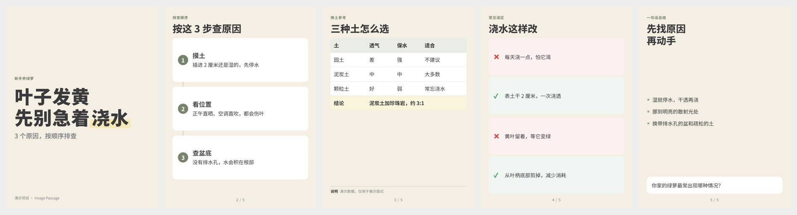

# Image Passage：图文策划与出图

[English](README.en.md) · MIT License · v0.2.0

面向**小红书**和**微信贴图号**的 3:4 图文笔记：把一句话、一段经历或一堆素材，做成一套可以直接发布的图文。

**策划 → 逐页出图 → 发布文案 → 质检 → 如实交付**

最终交付四项：**标题、正文（末尾附标签）、图片、首条评论**。默认上限：标题 20 字、正文 800 字、图片 15 张、标签 8 个。

同一份规则可以三种方式使用：

- **WorkBuddy 专家**「图文策划师」
- **Agent Skill**，用于 Claude Code、Codex 和其他支持 `SKILL.md` 的 Agent
- **普通仓库**：任何能读文件的 AI 都可以按 `skills/image-passage/SKILL.md` 执行



<sub>演示项目 `examples/demo/`：svg 路线（不需要任何生图能力），HTML＋CSS 渲染为 1242×1656 PNG。</sub>

## 功能

- **按能力分流出图**，不看模型名字：
  - 能生图（环境自带生图工具）→ `native`
  - 只能写文字 → `svg`：模型写 HTML＋CSS＋内联 SVG，脚本用 Chromium 渲染成 PNG
  - 在 `.env` 配置了 OpenAI 兼容图片接口 → `api`
- **每页三种构成方式**，按页面自动选择：
  - **G 整图生成**（Generate）：整页交给生图模型画，适合字少、以画面为主的页，例如封面大图。
  - **H 底图＋叠字**（Hybrid）：生图模型只画留白的背景和插画，文字和截图由代码精确叠加上去。适合字多、有表格、要原样放截图的页。
  - **S 纯排版**（Static）：完全用 HTML＋CSS 排版渲染，不用生图模型。适合不能生图的环境和排版型风格。
  - 生图模型容易写错中文，所以上图文字超过 30 字、超过 4 个要点或有表格时，自动从 G 改用 H。
- **白盒**：每页先写规格单 `spec.md`，再编译成 `prompt.md` 或 `page.html`，全部存档。默认不在对话里展示提示词，但随时可以查看和修改。
- **结构化策划库**：20 个主题领域、18 种读者价值、23 种内容模板、5 种篇幅、15 种钩子、12 种视觉风格、36 种版式、13 种封面、39 种表达元素。
- **风格锁**：P1 确认后锁定 13 项视觉参数；颜色用名字描述，脚本推导 HEX 生成 `tokens.css`。
- **可选的账号配置**：首次使用可直接开始，也可快速设置、完整设置，或从过往笔记截图提取风格；每次结束问一次是否存为默认。
- **多种输入**：文字、截图、照片、文档（pdf/docx/pptx/xlsx/csv/html）、链接、音频、视频（可选转写接口＋ffmpeg 抽帧）。
- **可选的账号角色**：默认不启用。可以上传自己的角色图，或用内置提示词模板生成角色设定图、表情组、动作图。
- **首条评论**：每篇配一条由账号自己发出的首条评论，用来补充信息、说明条件或抛出讨论问题，不复述正文，不写导流和诱导口令。
- **质检**：渲染脚本检查溢出、出界、字号、字体、图片、重叠、高亮数量；文案脚本检查标题、字数档、标签、首条评论、绝对化用语、功效和收益承诺、诱导互动；无法看图时如实标「未经视觉检查」。
- **开源字体**：思源黑体、霞鹜文楷等 8 款 OFL 字体，按需下载。

## 安装

### Claude Code

```text
/plugin marketplace add chans-gh/Image-Passage-IP
/plugin install image-passage@image-passage-ip
```

也可以只装技能：把 `skills/image-passage` 复制或链接到 `~/.claude/skills/`（全局）或项目的 `.claude/skills/`。

### Codex

```bash
git clone https://github.com/chans-gh/Image-Passage-IP.git
mkdir -p ~/.agents/skills
ln -s "$PWD/Image-Passage-IP/skills/image-passage" ~/.agents/skills/image-passage
```

只想在某个项目里用，就链接到该项目的 `.agents/skills/`。`skills/image-passage/agents/openai.yaml` 提供显示名和默认提示。

### WorkBuddy

仓库根目录的 `.codebuddy-plugin/plugin.json` 定义了专家「图文策划师」（身份与开场在 `agents/image-passage.md`，技能在 `skills/image-passage/`）。上架所需的字段、要求和打包命令见 [docs/workbuddy-submission.md](docs/workbuddy-submission.md)：

```bash
python3 tools/workbuddy_package.py zip
```

### 其他 Agent

让 Agent 读取 `skills/image-passage/SKILL.md` 并按其执行。规则只依赖文件，脚本不可用时也能手工完成，报告会说明哪些检查没有执行。

## 依赖

出图和检查脚本需要 Python 3.9+。在仓库根目录：

```bash
pip install -r skills/image-passage/scripts/requirements.txt
```

```bash
python -m playwright install chromium
```

```bash
python3 skills/image-passage/scripts/fetch_fonts.py
```

可选：`ffmpeg`（视频抽帧、音频提取）、`tesseract` 加 `chi_sim` 语言包（OCR 核对）。

检查当前环境能走哪条路线：

```bash
python3 skills/image-passage/scripts/env_check.py
```

## 配置 `.env`（可选）

只有 `api` 路线和音视频转写需要。复制 `.env.example` 为 `.env`，放在运行 Agent 的目录或 `image-passage-work/` 下：

| 变量 | 作用 |
|---|---|
| `RENDER_MODE` | `auto`（默认）/ `native` / `svg` / `api` |
| `IMAGE_API_BASE_URL`、`IMAGE_API_KEY`、`IMAGE_API_MODEL` | OpenAI 兼容图片接口（`/images/generations`、`/images/edits`） |
| `IMAGE_API_SIZE`、`IMAGE_API_REFERENCE_MODE`、`IMAGE_API_QUALITY` | 尺寸、参考图传递方式、质量参数 |
| `TRANSCRIBE_API_*` | OpenAI 兼容转写接口（`/audio/transcriptions`） |
| `IMAGE_PASSAGE_WORKDIR`、`IMAGE_PASSAGE_FONT_DIR` | 工作区和字体缓存目录 |

`.env` 已被 `.gitignore` 忽略。**不要在对话里发送 KEY**；脚本不会打印 KEY，`--dry-run` 显示的请求里 KEY 已遮挡。

## 使用

对 Agent 说：

- 「帮我做一套关于……的图文」：全流程，默认在**策划**和 **P1 封面**两处等你确认
- 「只策划，先不出图」「只写标题、正文和首条评论」「做一张……」
- 「改第 3 页的标题」「继续」「看一下 P3 的提示词」
- 「设置账号」「做一个账号角色」

工作文件写在当前目录的 `image-passage-work/<项目名>/`：

```
inputs/  inputs.md  plan.md  style-lock.md  state.json
render/{base.css, tokens.css}
pages/PNN/{spec.md, prompt.md, page.html, base.png, vN.png, qa.md}
final/PNN.png  copy.md
```

换会话也能接着做：Agent 先读 `state.json` 和 `plan.md`，不依赖对话记忆。

## 仓库结构

```
.claude-plugin/          Claude Code 插件与 marketplace 清单
.codebuddy-plugin/       WorkBuddy 专家清单
agents/image-passage.md  专家身份与开场（WorkBuddy / Claude Code 子代理）
avatars/expert.png       专家头像
skills/image-passage/    技能本体
├── SKILL.md             总览：原则、阶段、路线、脚本、参考索引
├── agents/openai.yaml   Codex 显示信息
├── references/          细则，按阶段需要时读取
├── templates/           项目文件模板（plan、spec、style-lock、state.json、page.html…）
├── scripts/             Python 脚本（渲染、质检、接口、素材提取）
└── assets/              颜色表、字体表、平台预设、base.css
examples/demo/           5 页演示（svg 路线）
tools/                   维护工具（WorkBuddy 清单检查与打包）
docs/                    设计文档、WorkBuddy 上架材料、V3.1 原始规则归档
```

给 AI 的维护说明见 [AGENTS.md](AGENTS.md)，文件索引见 [llms.txt](llms.txt)。

## 设计文档

| 文件 | 内容 |
|---|---|
| [docs/00_基础方案.md](docs/00_基础方案.md) | 定位、已确认决策、逻辑链路、出图分流摘要、角色资产、目录结构 |
| [docs/01_变量清单.md](docs/01_变量清单.md) | V3.1 规则中全部变量、类型与列举项盘点 |
| [docs/02_变量核查与扩充.md](docs/02_变量核查与扩充.md) | 变量核查与扩充：主题、模板、篇幅、版式、风格参数、价值与互动、表达元素、封面、文案 |
| [docs/03_运作流程.md](docs/03_运作流程.md) | 运作流程：初始化与个性化、输入形式与组合、出图方式与质检 |
| [docs/workbuddy-submission.md](docs/workbuddy-submission.md) | WorkBuddy 上架材料：可复制的字段、要求、打包与自测清单 |
| [docs/source-v3.1/](docs/source-v3.1/) | V3.1 原始规则归档（只读，迁移对照用） |

## 待完善

- Codex 和 WorkBuddy 的原生生图、看图能力由作者实测后补充（`references/render-routing.md` 末节）。
- G / H 构成方式的自动阈值（30 字、4 个要点）是初始值，欢迎根据实际效果反馈。
- 平台上限（标题 20 字、正文 800 字、图片 15 张、标签 8 个）由作者确认；平台规则变化时按 `references/platforms/*.md` 的说明更新。

欢迎提 Issue 和 PR。修改规则前请先读 [AGENTS.md](AGENTS.md)。

## 许可

代码和规则文件采用 [MIT](LICENSE)。专家头像 `avatars/expert.png` 是作者的形象，不在 MIT 授权范围内，未经作者许可请勿用于其他项目。下载的字体各自遵循 SIL Open Font License。使用本项目生成的内容，请遵守平台规则，并确保素材、肖像和角色的使用权。
